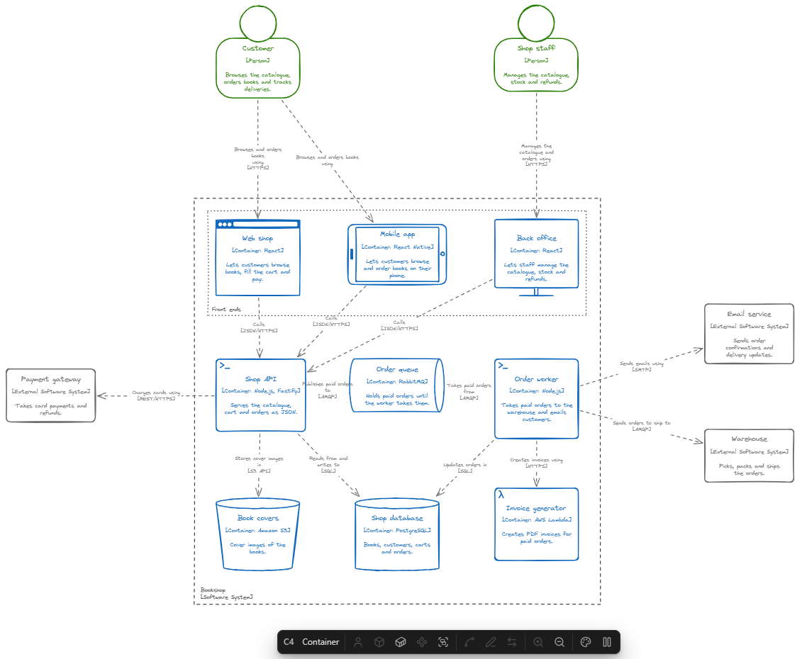
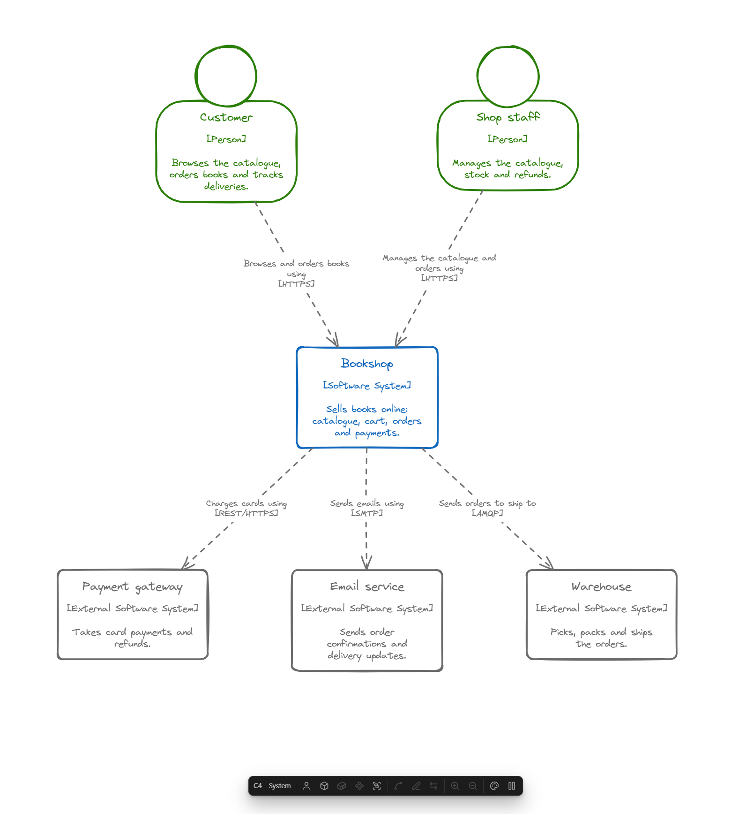

# Excalidraw C4 Model

Obsidian plugin that adds [C4 model](https://c4model.com) diagrams to Excalidraw drawings: people, software systems, containers, components and their relationships, drawn level by level. Requires the Excalidraw plugin.



## Usage

Open a drawing and add a person or a software system from the floating panel, or run a command such as "Add person". Select two elements and add a relationship between them. Select an internal system and press Enter to zoom into it and draw its containers.

| Key | Action |
|---|---|
| Insert | Add an element of the level, of the selected element's kind; with nothing selected in the system context, a person until the drawing has one, then a system. With two elements selected, add a relationship between them |
| Space | Edit the selected element or relationship |
| Enter | Zoom into the selected internal system or container |
| Backspace | Zoom out to the level above. It never deletes a C4 element; Delete does |
| Ctrl+G | Add a group around the selected elements and groups, instead of Excalidraw's own grouping |
| Arrow keys | Select the nearest element or relationship that way, instead of moving the selection |
| Shift+Arrow keys | Add the nearest element or relationship that way to the selection |

A double-click zooms into an internal system or container, and opens the form of any other element or relationship. These are the defaults; all keys can be changed in the settings, see [Keyboard shortcuts](#keyboard-shortcuts).

## Key Features

### 🔭 Levels you zoom through

A drawing is one C4 model, and its diagrams are levels you zoom through, one on the canvas at a time:

- **System context**: people and software systems.
- **Containers** of a software system: a dashed boundary labelled with the system holds its containers, and around it are the people and systems it talks to.
- **Components** of a container: its components inside the container's boundary, and around it the other containers of the system and the people and systems outside.

Please note that **code** level is not supported, because you wouldn't use it anyway. :)

Zooming into a system opens it in place: the boundary takes the place of its box, and the elements around keep their places. The levels above stay in view around it, dimmed, so the whole picture is never lost. Zooming in the first time creates the level, with the elements the system has relationships with. Each level edits only its own elements; what comes from the levels above is there for context and is edited there. The boundary grows and shrinks to fit what is in it.



### 🧱 Elements with their shapes

Add people, software systems, containers and components from the panel or the commands; each level offers only its own kinds. People and systems can be **external**, and the containers and components of an external system are external too. A box shows the element's name, its kind and technology, and its description, as in the C4 model's diagrams.

Containers have a **type**, picked in their form, that gives their shape: **generic** and **server app** boxes, a **web app** browser window, a **mobile app** phone, a **desktop app** monitor, **function** and **job** boxes with a λ or a clock, a **message queue** pipe, a **database** cylinder, a **storage** bucket and a **directory** folder. People have a head, components the small boxes of the UML component symbol. Resize a box by hand and it keeps its new size, with its text in place.

Every element and relationship can also have **metadata**, key: value pairs added in its form. They are not drawn. An element drawn on several levels is one element: edit it on one and it changes on all of them.

### ➡️ Relationships across levels

A relationship goes from the element selected first to the other one, which can also be a dimmed element of a level above: it is drawn in the level then, where it was; its form, the edit form and a command can reverse it. Two elements can have any number of relationships, either way; they lie side by side and stay apart when a box moves.

A relationship drawn on one level also appears on the levels above, between the elements containing its ends: `Customer → Web shop` in the containers of the Bookshop puts `Customer → Bookshop` in the system context, unless the two already have a relationship there, either way. Going down, the relationships of a system come into its level as arrows to its boundary, to be moved onto the containers they are about. Editing a relationship edits its copies on the levels below; the levels above keep what they say. Deleting the last relationship between two elements deletes every relationship below between them and anything inside them, either way.

### 🗂️ Groups

A **group** is a dotted box with a name around elements that belong together, such as the containers of a microservice. Add one with Ctrl+G or from the panel. Groups nest, fit what is in them, and are shown only on their own level. Drag an element into or out of a group to change it; drag a group and what is in it comes along. Deleting a group leaves its elements.

### 🧭 Moving elements between parents

Drag a system's boundary and its containers and label come along. Drag a container out of its system's boundary and it is marked with a thick red dashed outline until it is back, as is anything dropped into a boundary it does not belong in. Drop a container onto another internal system, or a component onto another container, and it moves there, with its relationships.

### ⌨️ Keyboard-first editing

Add elements and relationships, edit them, zoom in and out, and move the selection with the arrow keys, without touching the mouse. What is selected is outlined in the accent color, clearer than Excalidraw's own selection, and numbered when more than one thing is selected, in the order a relationship between them would go.

### 🎨 Themes and your colors

Each drawing has its own **theme**, picked from the panel's theme menu or with the command "Change theme of the drawing". The built-in ones are **Classic** (the key of the C4 model's diagrams), **Filled** (the well-known filled C4 boxes), **Pastel**, **Ocean**, **Sunset**, **Forest** and **Monochrome**; your own themes follow them. New drawings get the theme set in the settings.

Every type of element has its colors: people, software systems, each type of container, components, external elements and groups. Any element can also have colors of its own, set in its form.

### ✏️ Still plain Excalidraw

The boxes and arrows are ordinary Excalidraw elements with their C4 data attached, so every Excalidraw tool still works on them, and a drawing stays a normal Excalidraw drawing without the plugin: it shows the level it was saved on. Pause the plugin from the panel, or with the command "Pause or resume C4 editing", when you want Excalidraw's own keys and double-clicks back.

### 🤝 Next to other diagram plugins

Other plugins may draw their own kind of diagram in Excalidraw drawings too, such as [Excalidraw Mind Map](https://github.com/Dzoukr/ExcalidrawMindmapObsidianPlugin). Each drawing belongs to one of them, so their panels, keys and double-clicks never get in each other's way. The plugins need not know each other, only conventions they all follow (`src/mode.ts`):

- **The drawing's kind is in its frontmatter**: `dzoukr-diagram-kind: c4` for a C4 drawing, out of the `excalidraw-` keys the Excalidraw plugin keeps for itself. This plugin writes it when it takes a drawing over, and leaves a drawing of another kind alone.
- **A registry on the window**: the map `window.dzoukrDiagramKinds` holds, for the kind of each such plugin while it is enabled, the version of these conventions it follows (`{ version: 1 }`). The conventions only change in ways plugins following an earlier version still work with; a change they would not work with raises the version.
- **A shared chooser row** (`src/chooser.ts`): on a drawing nobody's yet, each plugin puts one `button.dzoukr-diagram-choice` (its kind in `data-kind`) into the `div.dzoukr-diagram-chooser` of the view, "Use this drawing for: C4 diagrams · …", made by the first and removed by the last, all styling it alike; its own panel is hidden there. Last in the row, **Excalidraw** keeps the drawing plain: it writes the kind `excalidraw`, which every plugin leaves alone as it does any kind not its own. Whichever plugin offers first adds that button, and takes it out when it leaves.

| Drawing | C4 plugin alone | With another such plugin |
|---|---|---|
| Kind `c4` | C4's: the whole panel | C4's: the whole panel |
| Another kind | panel hidden, plugin silent | panel hidden, plugin silent |
| No kind, with C4 elements | C4's; the kind is written | C4's; the kind is written |
| No kind, anything else (empty included) | C4's; nobody's with **Ask what a new drawing is for** on | nobody's: no panel, a **C4 diagrams** button in a row shared with the other plugins, keys left to Excalidraw |

- The **C4 diagrams** button in the row "Use this drawing for", the command "Use this drawing for C4 diagrams", or any C4 command on a drawing nobody's yet takes it over: its kind is written. The command also takes over another plugin's drawing; what that plugin drew stays as plain shapes.
- The command "Keep this drawing plain Excalidraw" does the same as the **Excalidraw** button, on any drawing, a C4 one included (its elements stay as plain shapes).
- The kind of a drawing with C4 elements and none is written once its first element is drawn, or when one drawn before kinds is open; only while the drawing has no unsaved changes.
- Silent means: no keys, double-clicks, selection outline, redrawing in new colors or marks of misplaced elements. C4 commands are not offered on another plugin's drawing.

## Configuration

All options are in **Settings → Excalidraw C4 Model**.

| Setting | Default | Description |
|---|---|---|
| Show panel | On | Buttons for adding, connecting and editing elements, docked on every drawing. |
| Panel position | Right | A row at the bottom or top of the drawing, or a column on its left or right side. |
| Ask what a new drawing is for | Off | On a drawing without C4 elements that is not yet anybody's, offers C4 diagrams or plain Excalidraw instead of taking it over. With another plugin drawing its own kind of diagram enabled, the plugins always ask. |
| Theme of new drawings | Classic | The colors of new drawings: a built-in theme or one of your own. Each drawing keeps its own. |

**Themes** are on their own page in the settings. Add a theme starting from a built-in one or one of yours, reorder them, and rename or delete one from its page. Each theme has an outline, a fill and a text color for every type of element (groups have no fill), and **Reset colors to defaults** restores the Classic ones. Export all your themes as JSON, to the clipboard or a file in the vault, and import them in another vault, from the clipboard or a file. A drawing whose theme was deleted gets the Classic colors.

### Keyboard shortcuts

The **Keyboard shortcuts** section of the settings lists the key of every action in the drawing: adding an element, adding a group, zooming in and out, editing, and selecting the nearest element in each direction. Record a new key for an action, turn it off, or restore its default. The commands, such as "Add relationship between the two selected elements", get hotkeys in Obsidian's own **Hotkeys** settings.

## Development

```
npm install
npm run dev     # watch build, copies into test-vault/.obsidian/plugins/excalidraw-c-four-model
npm run build   # type-check + production build
npm test        # unit tests
npm run lint    # ESLint with Obsidian's plugin rules
```

The design is described in [docs/design.md](docs/design.md).

To install into a vault manually, copy `main.js`, `manifest.json` and `styles.css` from the [latest release](https://github.com/Dzoukr/ExcalidrawC4ObsidianPlugin/releases/latest) into `<vault>/.obsidian/plugins/excalidraw-c-four-model/`.

## License

[MIT](LICENSE)
